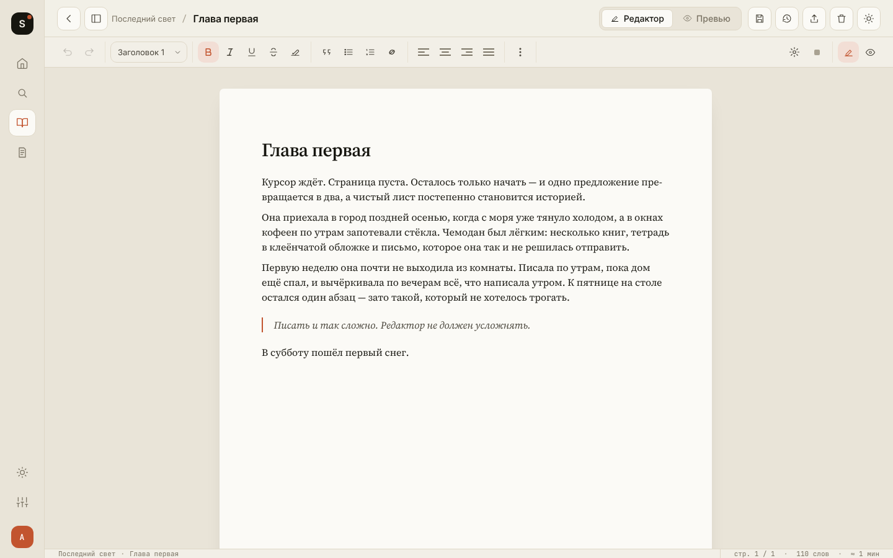

# Sipru.

Минималистичный редактор для писателей: бумага и чернила, спокойная типографика, ничего лишнего.
Работает локально — без регистрации, сервера и подписок.

**[Сайт и загрузки — sipru.pro](https://sipru.pro)** · **[Веб-версия](https://dantemorrigan.github.io/sipru/)** · **[Все релизы](https://github.com/dantemorrigan/sipru/releases/latest)**



---

## Скачать

| Платформа | Файл | Примечание |
|---|---|---|
| macOS 10.15+ (Apple Silicon и Intel) | `Sipru_<версия>_universal.dmg` | При первом запуске — см. [«Установка на macOS»](#установка-на-macos) |
| Windows 10 / 11 | `Sipru_<версия>_x64-setup.exe` | Ставится в профиль пользователя, права администратора не нужны |
| Android 7+ | `Sipru-<версия>-Android.apk` | Разрешите установку из этого источника, когда телефон спросит |

Последняя версия всегда на странице [Releases](https://github.com/dantemorrigan/sipru/releases/latest)
и на [sipru.pro](https://sipru.pro). Приложение само проверяет обновления и предлагает скачать новую версию.

### Установка на macOS

Sipru. не подписан платным сертификатом Apple, поэтому macOS при первом запуске может сказать,
что приложение «повреждено» или «не удалось проверить». Это не так — просто Apple его не знает.

1. Откройте `.dmg` и перетащите **Sipru** в папку **«Программы»**.
2. Откройте **Терминал** (Launchpad → «Другие» → «Терминал» или поиск Spotlight ⌘ Пробел).
3. Вставьте команду и нажмите Enter:

   ```bash
   xattr -cr /Applications/Sipru.app
   ```

4. Запустите Sipru. как обычно. Повторять это нужно только после установки новой версии.

Команда снимает с приложения пометку «скачано из интернета» — и больше ничего не меняет.
Без Терминала: попробуйте открыть Sipru., затем **Системные настройки → Конфиденциальность и безопасность →
«Всё равно открыть»**.

---

## Возможности

**Письмо**
- Проекты с главами (перетаскиваются мышью) и отдельный поток заметок
- Форматирование: жирный, курсив, подчёркнутый, зачёркнутый, маркер, заголовки H1–H6, цитаты,
  эпиграфы, списки и задачи, таблицы, блоки кода, изображения, сноски, разрывы страниц и сцен
- Настоящие страницы: формат (A4, A5, A6, B5, Letter, Legal), ориентация, поля, колонтитулы, масштаб
- Фокус-режим, режим превью, оглавление главы
- Автосохранение, отмена/повтор, версии главы (последние 30, восстановление в один клик)
- Поиск по проектам, главам и тексту (⌘/Ctrl+K)
- Цели: число слов на проект, дневная норма, серия дней подряд

**Импорт и экспорт**
- Импорт TXT, Markdown и HTML — новой заметкой или главой
- Экспорт книги в PDF (через печать), `.docx`, TXT и Markdown: выбор глав, шрифт, поля,
  нумерация страниц, оглавление, титульный лист

**Данные**
- Всё хранится на устройстве; ничего не отправляется на сервер
- **Хранилище (vault)**: выберите обычную папку — проекты станут папками, главы и заметки — `.md` файлами,
  которые открываются любым редактором и переживают переустановку приложения
- Резервная копия всего в один JSON-файл и восстановление из него

**Интерфейс**
- Русский и английский языки, светлая и тёмная темы
- Шрифты текста: Source Serif 4, Lora, JetBrains Mono
- Горячие клавиши работают на любой раскладке

<details>
<summary>Горячие клавиши</summary>

На macOS — ⌘, на Windows и Linux — Ctrl.

| Действие | Клавиши |
|---|---|
| Жирный / курсив / подчёркнутый | ⌘B · ⌘I · ⌘U |
| Зачёркнутый / маркер | ⌘⇧X · ⌘⇧H |
| Ссылка | ⌘K (в редакторе) |
| Заголовки H1–H6 / обычный текст | ⌘⌥1…6 · ⌘⌥0 |
| Нумерованный / маркированный список / цитата | ⌘⇧7 · ⌘⇧8 · ⌘⇧9 |
| Выравнивание: влево · по центру · вправо · по ширине | ⌘⇧L · ⌘⇧E · ⌘⇧R · ⌘⇧J |
| Отменить / повторить | ⌘Z · ⌘⇧Z (и Ctrl+Y) |
| Сохранить | ⌘S |
| Разрыв страницы | ⌘⏎ |
| Сноска | ⌘⌥F |
| Фокус-режим / превью | ⌘⇧F · ⌘⌥P |
| Снять форматирование | ⌘\ |
| Отступ в списке | Tab · ⇧Tab |
| Поиск | ⌘K (вне редактора) |

</details>


---

## Как хранятся данные

`localStorage` — рабочая копия: каждое изменение пишется туда сразу. Папка хранилища — долговечная
копия: в неё уходит отложенная запись после каждого изменения. Если запись в папку не удалась,
приложение продолжает работать на `localStorage`, так что сломанный диск не может стоить вам текста.

```
<хранилище>/
├── sipru-vault.json            настройки и версия схемы
├── <Название проекта>/
│   ├── sipru-meta.json         метаданные проекта и версии глав
│   └── 01 Название главы.md
└── Notes/
    ├── sipru-meta.json
    └── Название заметки.md
```

| | macOS / Windows | Android |
|---|---|---|
| Выбор папки | системный диалог | системный выбор папки (Storage Access Framework) |
| Разрешения | не нужны | не нужны — ни `MANAGE_EXTERNAL_STORAGE`, ни storage-permissions |
| После переустановки | файлы на месте, папка подключается сама | файлы на месте, папку нужно выбрать заново одним касанием |

На Android нет пути, который был бы одновременно видимым пользователю и долговечным для файлового
плагина Tauri, поэтому хранилище работает через SAF. Нативная часть моста — в
`.github/scripts/android_vault.py`, она встраивается в `MainActivity` при сборке.

---

## Разработка

Без фреймворков и бандлеров: React 18 лежит в `vendor/` как обычный UMD-скрипт, а исходники `.jsx`
транспилируются esbuild'ом один-в-один в `build/*.js`. Каждый файл подключается отдельным `<script>`
в `index.html`, порядок подключения важен.

```bash
npm ci            # один раз
npm run build     # после правки любого .jsx — build/ коммитится вместе с исходниками
npm run check     # проверить, что build/ соответствует исходникам
npm test          # пересборка + все тесты
python3 -m http.server 8000   # запустить веб-версию на http://localhost:8000
```

`npm test` прогоняет:

| Набор | Где | Что проверяет |
|---|---|---|
| `test/store.js` | Node | стор, миграции, бэкапы, лимиты |
| `test/i18n.js` | Node | полнота переводов RU/EN |
| `test/roundtrip.html` | Chromium | Markdown/HTML/DOCX туда и обратно |
| `test/editor.js` | Chromium | реальный редактор: ввод, отмена, вставка, касания |
| `test/pagination.js` | Chromium | вёрстка страниц во всех форматах × ориентациях × масштабах |
| `test/export.js` | Chromium | титульный лист в превью экспорта |

Браузерным наборам нужен Playwright (`npm i -g playwright && npx playwright install chromium`);
без него они пропускаются.

Десктопные и мобильные сборки — [Tauri 2](https://tauri.app):

```bash
npx tauri dev                              # десктоп
npx tauri build                            # установщик для текущей ОС
npx tauri android init && npx tauri android build --apk
```

### Структура

```
index.html               точка входа, порядок <script>
store.js                 стор: localStorage, схема и миграции, CRUD, версии, цели, бэкап
engine.js                схема документа и нормализация после каждой правки
formats.js               импорт TXT/MD/HTML, генератор .docx
vault.js                 хранилище на диске (.md файлы), десктоп и Android
i18n.js                  строки RU/EN
haptics.js               тактильный отклик на сенсорных экранах
components.jsx           иконки, общие компоненты и хуки
shell.jsx                рамка приложения: боковая панель, мобильная навигация
screens-onboarding.jsx   первый запуск: язык → имя → тема → хранилище
screens-dashboard.jsx    библиотека, проект, статистика
editor-page.jsx          геометрия страниц и пагинация
editor-outline.jsx       оглавление главы
screens-editor.jsx       редактор, тулбар, фокус-режим, превью, версии
screens-export.jsx       превью книги и экспорт
screens-profile.jsx      профиль, тема, хранилище, бэкап
tour.jsx                 обучающий тур (десктоп)
updater.jsx              проверка обновлений по кнопкам загрузки на sipru.pro
app.jsx                  корень приложения и маршрутизация
styles.css · ui.css · frame.css · tour.css
build/                   скомпилированный JS (генерируется, коммитится)
vendor/                  React и ReactDOM
src-tauri/               оболочка Tauri (macOS, Windows, Android)
test/                    тесты
docs/                    скриншоты и макеты дизайна
```

### Релизы и деплой

- **Веб-версия** публикуется на GitHub Pages при каждом пуше в `main` (`deploy.yml`).
- **Сборки** macOS, Windows и Android собираются на каждый пуш в `main` как артефакты Actions.
- **Релиз**: поднимите версию в `package.json`, `package-lock.json`, `src-tauri/tauri.conf.json`,
  `src-tauri/Cargo.toml` и `src-tauri/Cargo.lock`, добавьте раздел в [`CHANGELOG.md`](CHANGELOG.md)
  и влейте в `main`. Workflow `release.yml` соберёт все три платформы и опубликует GitHub Release
  `v<версия>` с файлами. После этого обновите ссылки «Скачать» на сайте
  ([dantemorrigan/sipru-site](https://github.com/dantemorrigan/sipru-site)) — по ним же приложение
  узнаёт о новой версии.

---

## Поддержка

Sipru. бесплатен. Поддержать разработку можно на
[Boosty](https://boosty.to/dante_morr/purchase/4062968?ssource=DIRECT&share=subscription_link).
Вопросы и предложения — в [Issues](https://github.com/dantemorrigan/sipru/issues).
